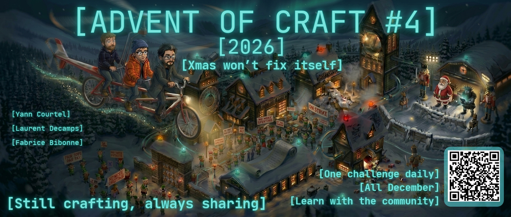

<p align="right"><sub><a href="README_EN.md">Read in English →</a></sub></p>

<div align="center">

[](https://www.adventofcraft.com/)

# Advent of Craft 2026

**Noël ne se réparera pas tout seul.**

[](https://www.adventofcraft.com/) [](challenges/README.md) [](https://discord.gg/qEVTkqD4E) [](https://www.linkedin.com/company/advent-of-craft)

</div>

## 🎄 Bienvenue à Xmas Town

Bienvenue dans la quatrième édition d’Advent of Craft ! Cette année, toute une ville compte sur vous.

À Xmas Town, les systèmes lâchent et l’eau vient à manquer. L’équipe du Père Noël a laissé l’IA modifier le code sans vraiment garder la main. Maintenant qu’il faut réparer, la moitié de l’équipe est partie.

Dans l’atelier, c’est le chaos : les elfes sont en grève, les chaînes de fabrication sont à l’arrêt et ce qu’il reste de l’équipe technique ne sait plus par où commencer. Chaque jour, c’est un nouvel incident qui apparaît, et pas de solution en vue.

**C’est un Noël sans cadeaux que les enfants du monde entier vont vivre si personne ne leur vient en aide.**

Alberon, le nouveau directeur technique, aime les systèmes solides. Et il se méfie de l’IA. Le Père Noël et lui attendent des renforts : vous voilà. Il va falloir lire le code, comprendre ce qui se passe et remettre la ville sur pied.

> [!IMPORTANT]
> **Pour commencer : le Jour 0, le test d’Alberon.** Retrouvez son centre de contrôle en suivant le câblage de la ville. Quinze minutes, ouvert jusqu’au 1er décembre.
>
> Le code de la porte vous ouvre le centre de contrôle sur le [site](https://www.adventofcraft.com/) avant tout le monde. Nous le résolvons en direct le lundi 30 novembre, la veille de l’ouverture du calendrier : l’heure et le lien seront sur [Discord](https://discord.gg/qEVTkqD4E) et [LinkedIn](https://www.linkedin.com/company/advent-of-craft).
>
> → [Jour 0 : le test d’Alberon](challenges/day00/README.md)

## Ce qui vous attend

Vous lirez du code inconnu, sécuriserez vos changements avec des tests, simplifierez des systèmes et examinerez leur coût en ressources.

Que vous découvriez le software craft ou que vous le pratiquiez depuis des années, vous êtes les bienvenu(e)s. Venez avec votre IDE, vos questions et un peu de temps pour essayer.

- 📅 **Un défi par jour, du 1er au 24 décembre 2026**, avec un énoncé en français et en anglais.
- ⏱️ **40 minutes au plus**, selon le temps indiqué dans l’énoncé.
- 💻 **Java, C#, Kotlin et TypeScript**, avec d’autres langages selon les jours.
- 💡 **Une proposition de solution et son explication pas à pas le lendemain.**

Chaque exercice est indépendant. Rejoignez-nous en cours de route, sautez un jour ou travaillez avec un collègue : vous n’aurez pas besoin du code de la veille pour commencer.

Ce dépôt rassemble les énoncés, le code de départ et les solutions :

| Dossier | Contenu |
| --- | --- |
| [challenges/](challenges/README.md) | Énoncés du jour en anglais et en français |
| [exercises/](exercises/) | Code de départ, dans `dayNN/<stack>/` |
| [solutions/](solutions/) | Explications pas à pas et code des solutions, publiés le lendemain |

Pour suivre l’aventure et le calendrier, rendez-vous sur [adventofcraft.com](https://www.adventofcraft.com/).

## Choisissez un défi et lancez-vous

**Forkez** → **clonez** → **lisez l’énoncé** → **lancez les tests** → **réglez un minuteur**

1. Choisissez un jour disponible dans la [liste des défis](challenges/README.md) ou sur le [site](https://www.adventofcraft.com/).
2. Lisez son énoncé, en français ou en anglais. Vous y trouverez la situation, votre mission et les contraintes.
3. Forkez ce dépôt sur GitHub, puis clonez votre fork. Votre travail y reste, et vous pourrez le partager à la fin :

   ```sh
   git clone https://github.com/<votre-compte>/2026.git
   cd 2026
   git remote add upstream https://github.com/advent-of-craft/2026.git
   ```

   Chaque jour, récupérez le nouveau défi avec `git pull upstream main`.

4. Suivez le lien de l’énoncé vers votre langage. Le README du projet donne les prérequis et les commandes pour le lancer.
5. Lancez le code de départ, réglez un minuteur et essayez une approche.

## Avec IA, sans IA

Certains jours vous invitent à travailler à la main, d’autres avec un agent IA. L’énoncé vous précise le mode et sa raison.

| Sans IA | Avec IA |
| --- | --- |
| Prendre le temps de comprendre seul | Apprendre à collaborer avec un agent en gardant la main |
| Assistant désactivé, complétions IA comprises | Vous gardez les décisions : lisez ses propositions et vérifiez le résultat |
| Vous savez expliquer ce que vous avez trouvé | Vous savez expliquer chaque changement |

## Partager avec la communauté

Advent of Craft, c’est avant tout une invitation à échanger et à partager avec la communauté des crafters, quel que soit votre niveau. Personne ne vous jugera : partagez ce que vous savez et n’hésitez pas à poser vos questions, même celles qui vous paraissent simples. C’est comme ça qu’on apprend et qu’on grandit.

Partagez votre implémentation : un lien vers votre fork ou une branche sur [Discord](https://discord.gg/qEVTkqD4E) suffit. Inachevée, elle compte aussi.

Comparez-la avec celles des autres et avec la solution du lendemain. Il y a rarement un seul bon chemin, et c’est en voyant d’autres choix qu’on apprend le plus.

À votre tour, ne jugez pas : chacun vient avec son niveau, son langage et son temps. Commentez le code, jamais la personne, et signalez les spoilers pour laisser aux autres le plaisir de chercher.

**Still crafting, always sharing.**

## L’équipe

Advent of Craft 2026 est préparé par :

<div align="center">
<table>
  <tr>
    <td align="center" width="150">
      <a href="https://www.linkedin.com/in/laurentdecamps/"><br><sub><b>Laurent Decamps</b></sub></a>
    </td>
    <td align="center" width="150">
      <a href="https://www.linkedin.com/in/fabrice-bibonne-1729a1180/"><br><sub><b>Fabrice Bibonne</b></sub></a>
    </td>
    <td align="center" width="150">
      <a href="https://www.linkedin.com/in/yanncourtel/"><br><sub><b>Yann Courtel</b></sub></a>
    </td>
  </tr>
</table>
</div>

<div align="center">

[Licence MIT](LICENSE) · Éditions précédentes : [2023](https://github.com/advent-of-craft/2023) · [2024](https://github.com/advent-of-craft/2024) · [2025](https://github.com/advent-of-craft/2025)

</div>
