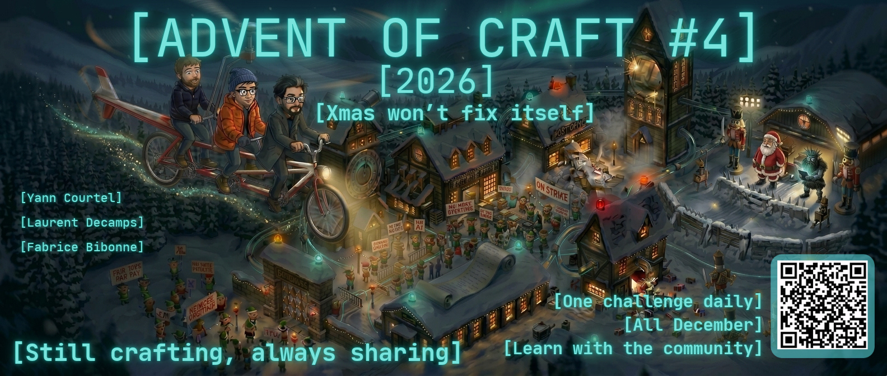

<p align="right"><sub><a href="README.md">Lire en français →</a></sub></p>

<div align="center">

[](https://www.adventofcraft.com/)

# Advent of Craft 2026

**Xmas won’t fix itself.**

[](https://www.adventofcraft.com/) [](challenges/README_EN.md) [](https://discord.gg/qEVTkqD4E) [](https://www.linkedin.com/company/advent-of-craft)

</div>

## 🎄 Welcome to Xmas Town

Welcome to the fourth edition of Advent of Craft! This year, a whole town is counting on you.

Systems are failing in Xmas Town, and water is running short. Santa’s team let AI change the code without keeping a close eye on the work. Now that repairs are needed, half the team has left.

The workshop is in chaos: the elves are on strike, the production lines have stopped, and what is left of the technical team no longer knows where to start. Every day brings a new incident, and no solution in sight.

**A Christmas without presents is what awaits children all over the world, if no one comes to their rescue.**

Alberon, the new CTO, likes sturdy systems. And he is wary of AI. He and Santa are waiting for reinforcements: that’s you. There’s code to read, trouble to understand, and a town to get working again.

> [!IMPORTANT]
> **Start with Day 0, Alberon’s test.** Find his control center by following the town’s wiring. Fifteen minutes, open until 1 December.
>
> The door code opens the control center on the [website](https://www.adventofcraft.com/) before everyone else. We solve it live on Monday 30 November, the day before the calendar opens: the time and the link will be on [Discord](https://discord.gg/qEVTkqD4E) and [LinkedIn](https://www.linkedin.com/company/advent-of-craft).
>
> → [Day 0: Alberon’s test](challenges/day00/README_EN.md)

## What to expect

You’ll read unfamiliar code, protect changes with tests, simplify systems, and examine their resource use.

Whether you’re discovering software craft or have been practising it for years, you’re welcome. Bring your IDE, your questions, and a little time to try something.

- 📅 **One challenge a day, from 1 to 24 December 2026**, with briefs in French and English.
- ⏱️ **40 minutes at most**, following the timebox in the brief.
- 💻 **Java, C#, Kotlin and TypeScript**, with other languages available on some days.
- 💡 **A proposed solution and walkthrough the following day.**

Each exercise is independent. Join along the way, skip a day, or work through one with a colleague: you won’t need yesterday’s code to get started.

This repository holds the briefs, starting code, and solutions:

| Folder | What’s inside |
| --- | --- |
| [challenges/](challenges/README_EN.md) | Daily briefs in English and French |
| [exercises/](exercises/) | Starting code, under `dayNN/<stack>/` |
| [solutions/](solutions/) | Walkthroughs and solution code, released the next day |

To follow the adventure and the calendar, head to [adventofcraft.com](https://www.adventofcraft.com/).

## Pick a challenge and get started

**Fork** → **clone** → **read the brief** → **run the tests** → **set a timer**

1. Choose an available day in the [challenge index](challenges/README_EN.md) or on the [website](https://www.adventofcraft.com/).
2. Read its brief, in English or French. It explains the situation, your task, and the constraints.
3. Fork this repository on GitHub, then clone your fork. Your work stays there, and you can share it at the end:

   ```sh
   git clone https://github.com/<your-account>/2026.git
   cd 2026
   git remote add upstream https://github.com/advent-of-craft/2026.git
   ```

   Each day, get the new challenge with `git pull upstream main`.

4. Follow the brief’s link to your language. The project’s README gives you the prerequisites and commands to run it.
5. Run the starting code, set a timer, and try an approach.

## With AI, without AI

Some days ask you to work by hand, others with an AI agent. The brief tells you which, and why.

| Without AI | With AI |
| --- | --- |
| Take the time to understand it yourself | Learn to collaborate with an agent while keeping control |
| Assistant off, AI completions included | You make the decisions: read what it proposes and check the result |
| You can explain what you found | You can explain every change |

## Sharing with the community

Advent of Craft is first of all an invitation to talk and share with the crafter community, whatever your level. You won’t be judged: share what you know, and don’t be shy to ask, even the questions that seem basic. That’s how we learn and grow.

Share your implementation: a link to your fork or a branch on [Discord](https://discord.gg/qEVTkqD4E) is enough. An unfinished one counts too.

Compare it with other people’s and with the next day’s solution. There’s rarely a single right path, and seeing other choices is where you learn the most.

In return, don’t judge: everyone comes with their own level, language and time. Comment on the code, never the person, and flag spoilers so others can have their own go.

**Still crafting, always sharing.**

## The team

Advent of Craft 2026 is put together by:

<div align="center">
<table>
  <tr>
    <td align="center" width="150">
      <a href="https://www.linkedin.com/in/laurentdecamps/"><br><sub><b>Laurent Decamps</b></sub></a>
    </td>
    <td align="center" width="150">
      <a href="https://www.linkedin.com/in/fabrice-bibonne-1729a1180/"><br><sub><b>Fabrice Bibonne</b></sub></a>
    </td>
    <td align="center" width="150">
      <a href="https://www.linkedin.com/in/yanncourtel/"><br><sub><b>Yann Courtel</b></sub></a>
    </td>
  </tr>
</table>
</div>

<div align="center">

[MIT license](LICENSE) · Previous editions: [2023](https://github.com/advent-of-craft/2023) · [2024](https://github.com/advent-of-craft/2024) · [2025](https://github.com/advent-of-craft/2025)

</div>
