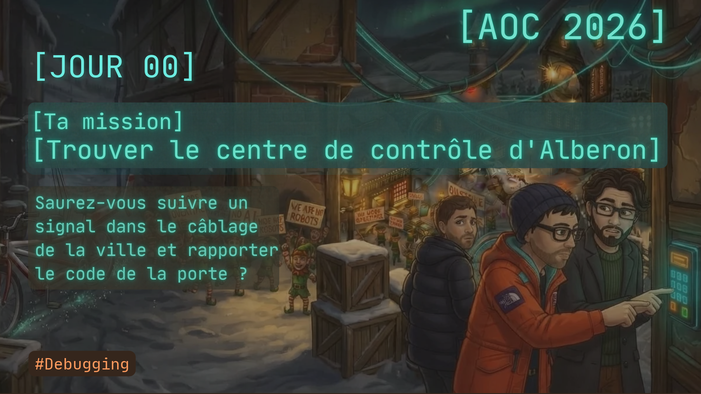

# Jour 0 : le test d'Alberon

## Le scénario

Alberon a installé un centre de contrôle d'où l'on voit tous les systèmes de la ville. Les elfes sont en grève et ne
doivent pas le trouver. Seuls les crafters capables de lire le câblage de la ville y arriveront.

Le câblage a été « amélioré » par quelqu'un qui ne travaille plus ici. Pendant les prochains jours, jusqu'au
1er décembre, Alberon y a branché un message : envoyez le bon signal et il vous mène à sa porte.

**L'exigence est simple :**
> Trouvez quand un signal parti des pompes à eau arrive jusqu'à Alberon, et rapportez le code de la porte.

## Votre mission (15 minutes)

**Lancez les tests** (2 min) → **Suivez le câblage** (8 min) → **Remplissez les blancs** (3 min) → **Ouvrez la porte** (2 min)

- Suivez le signal du test vert et voyez où il va. Ne modifiez pas le câblage : un test à vous, un print ou un point
  d'arrêt, ça va.
- Mettez l'heure dans `WHEN`, au format `HH:mm` (sur 24 h). L'échec du dernier test affiche le code de
  la porte : mettez-le à la place de `???`.
- Tapez le code dans le test d'Alberon sur [adventofcraft.com](https://adventofcraft.com/#day0). Le 1er décembre, la
  porte s'ouvre pour tout le monde.

## Le piège

L'endroit où arrive un signal dépend du signal que vous envoyez.

## Indice (si vous bloquez)

Indice

Passez au relais suivant à chaque fois, et lisez ce qu'il fait, pas ce qu'il dit de lui-même.

## Comment jouer

1. **Ouvrez le code sans votre agent :** les grévistes surveillent le trafic IA. Et ne tentez pas toutes les heures une
   à une : chaque signal envoyé passe par le vrai câblage.
2. **Faites le défi** en 15 minutes.
3. **Postez sur [Discord](https://discord.gg/qEVTkqD4E)** comment vous avez trouvé la porte et ce que vous en retenez.
   Gardez le code pour vous jusqu'au 1er décembre.
4. **Comparez** votre route avec celle des autres crafters.

## Pour démarrer

[Java](../../exercises/day00/java/README.md) · [C#](../../exercises/day00/csharp/README.md) · [Kotlin](../../exercises/day00/kotlin/README.md) ·
[TypeScript](../../exercises/day00/typescript/README.md)
