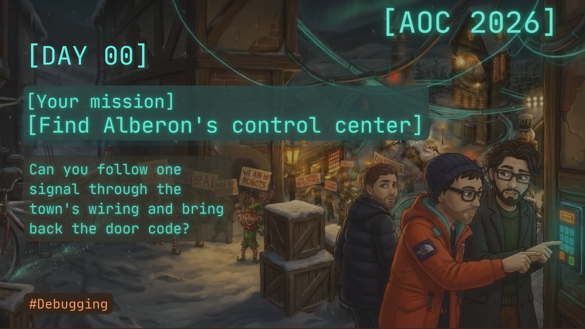

# Day 0: Alberon's test

## The Scenario

Alberon has set up a control center where every system in town can be watched. The elves are on strike and must not
find it. Only crafters who can read the town's wiring will.

The wiring was "improved" by someone who no longer works here. For the coming days, until 1 December, Alberon has
hooked a message to it: send the right signal and it leads you to his door.

**The actual requirement is simple:**
> Find when a signal from the water pumps reaches Alberon, and bring back the door code.

## Your Task (15 minutes)

**Run the tests** (2 min) → **Follow the wiring** (8 min) → **Fill in the blanks** (3 min) → **Open the door** (2 min)

- Follow the signal of the green test and see where it goes. Don't change the wiring: a test of your own, a print or a
  breakpoint is fine.
- Put the time in `WHEN` as `HH:mm` (24-hour). The last test's failure shows the door code: put it in
  place of `???`.
- Type the code in Alberon's test on [adventofcraft.com](https://adventofcraft.com/#day0). On 1 December, the door
  opens for everyone.

## The Trap

Where a signal lands depends on the signal you send.

## Hint (if stuck)

Hint

Go to the next relay each time, and read what it does, not what it says about itself.

## How to play

1. **Open the code without your agent:** the strikers watch the AI traffic. And don't try every time one by one: every
   signal you send goes through the real wiring.
2. **Do the challenge** in 15 minutes.
3. **Post on [Discord](https://discord.gg/qEVTkqD4E)** how you found the door and what you take away from it. Keep the
   code to yourself until 1 December.
4. **Compare** your route with the other crafters'.

## Getting started

[Java](../../exercises/day00/java/README.md) · [C#](../../exercises/day00/csharp/README.md) · [Kotlin](../../exercises/day00/kotlin/README.md) ·
[TypeScript](../../exercises/day00/typescript/README.md)
